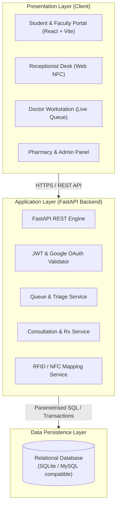

<div align="center">

# PulseCare (CampusCare)

### Smart Digital Health-Center Management System for Universities

[](#technology-stack)
[-009688?logo=fastapi&logoColor=white)](#technology-stack)
[](#technology-stack)
[](#technology-stack)
[--3A)-black?logo=nfc&logoColor=white)](#key-features)
[-4285F4?logo=google&logoColor=white)](#authentication--security)

A modern, paperless campus healthcare platform designed to streamline student check-ins, doctor queues, clinical consultations, and pharmacy dispensing using student NFC ID cards and institutional Google authentication.

</div>

---

## 📌 Executive Summary

University health centres often face long physical queues, misplaced paper prescriptions, and a lack of longitudinal patient medical history. 

**PulseCare** modernises this entire clinical journey into a unified, role-based digital system:
- **Instant Tap-and-Go Check-in:** Reads the student's existing RFID/NFC campus ID card via the browser's native **Web NFC API** on mobile/tablet — requiring **zero proprietary hardware**.
- **Live Doctor Queue & Triage:** Automatically routes students into doctor-specific queues, enabling staff to record vitals and doctors to review past medical history.
- **Structured E-Prescriptions & Dispensing:** Eliminates handwritten slips with structured dosage instructions and real-time pharmacy inventory tracking.
- **Institutional Integration:** Validates `@thapar.edu` Google Workspace accounts for secure student self-service.

---

## 🔄 End-to-End Clinical Workflow

```mermaid
flowchart LR
    A[Student / NFC Card Tap] -->|Web NFC / Roll No| B[Reception & Triage]
    B -->|Log Vitals: BP, Pulse, Temp| C[Doctor Queue]
    C -->|Consultation & History| D[Doctor Workstation]
    D -->|Structured E-Prescription| E[Pharmacy Dispensing]
    E -->|Medicine Handover| F[Completed Visit Record]
```



1. **Check-in:** The student taps their ID card on an NFC-enabled Android phone or tablet (or provides their roll number at the counter).
2. **Triage:** The receptionist verifies identity, logs basic vitals (BP, Heart Rate, Temperature, SpO2), and assigns the patient to an available doctor.
3. **Consultation:** The doctor calls the next patient from their real-time queue, reviews past medical history and allergies, documents clinical notes, and issues a structured digital prescription.
4. **Pharmacy Dispensing:** The pharmacy counter views pending prescriptions, confirms dispensing with stock safeguards, and completes the visit.
5. **Patient Record:** The complete visit summary and prescription are immediately accessible in the student's personal portal.

---

## 🚀 Key Modules & Portals

### 1. 🎓 Student & Faculty Portal
- **Profile & Health Info:** View verified academic details, blood group, emergency contacts, and known allergies.
- **Live Queue Tracking:** Monitor queue status and wait times in real time.
- **Digital Medical Record:** Instant access to all past visits, doctor notes, and active prescriptions.
- **Institutional Sign-In:** One-click Google OAuth restricted strictly to official `@thapar.edu` accounts.

### 2. 📋 Receptionist & Triage Desk
- **Tap-and-Go NFC Reader:** Instant student lookup by scanning their physical university smart card.
- **Manual Roll Number Search:** Fast fallback search for students without physical cards.
- **Vitals Recording:** Captures Blood Pressure, Heart Rate, Temperature, and SpO2 at check-in.
- **Dynamic Doctor Assignment:** Routes patients to available doctors based on clinic availability.

### 3. 🩺 Doctor Workstation
- **Live Patient Queue:** Active list of waiting patients with triage vitals displayed at a glance.
- **Patient Longitudinal History:** Full record of previous consultations, diagnoses, and medication responses.
- **Structured E-Prescription Writer:** Standardised fields for medicine name, dosage strength, form, frequency, duration, and food timing.
- **Queue Management:** Call next patient, mark consultation complete, or redirect to a colleague if needed.

### 4. 💊 Pharmacy & Inventory
- **Dispensing Queue:** Real-time feed of completed consultations awaiting medication pickup.
- **Stock Safeguards:** Prevents dispensing when inventory is insufficient and logs every transaction.
- **Emergency Case Logging:** Direct audit log for urgent walk-in trauma or emergency cases.

---

## 🏗️ System Architecture

PulseCare is architected as a clean, decoupled three-tier system:



### Architectural Highlights
- **Hardware-Free NFC:** Utilises the standard W3C **Web NFC API** (`window.NDEFReader`) supported in Chrome on Android. The server receives the card UID over HTTPS and maps it securely to the registered student record.
- **Authoritative Backend:** All state transitions (e.g. `WAITING` $\rightarrow$ `CALLED` $\rightarrow$ `IN_CONSULTATION` $\rightarrow$ `COMPLETED`) are enforced server-side with atomic transactions.
- **Role-Based Access Control (RBAC):** Every endpoint validates JWT claims with distinct permissions for Students, Faculty, Doctors, Receptionists, and Administrators.

---

## 🛠️ Technology Stack

| Layer | Technology | Purpose |
|---|---|---|
| **Frontend** | React 18, Vite | Responsive Single Page Application (SPA) |
| **Styling** | Tailwind CSS, Lucide Icons | Accessible, high-contrast healthcare UI |
| **Backend** | Python 3.11, FastAPI, Uvicorn | High-performance asynchronous REST API engine |
| **Security** | JWT (HS256), Google Auth Library | Token authentication & Thapar Workspace OAuth |
| **Hardware** | Web NFC API (W3C Standard) | Reading Mifare Classic 1K / ISO 14443-3A ID cards |
| **Database** | SQLite (Dev) / MySQL Compatible | Relational storage with foreign key integrity |
| **Server & Proxy** | Nginx, Uvicorn (ASGI) | Reverse proxy with SSL/TLS & asynchronous app server |
| **Cloud Hosting** | AWS EC2 (Ubuntu 24.04 LTS) | Production deployment with automated health checks |

---

## 📁 Repository Structure

```
pulse_care/
├── Code/
│   └── frontend/              # React 18 + Vite frontend application
│       ├── src/
│       │   ├── Components/    # Modular UI (Auth, Doctor, Reception, Students, Admin)
│       │   ├── App.jsx        # Route definitions and portal navigation
│       │   └── api.js         # Centralised API client with token interceptors
│       └── nginx.conf         # Reverse proxy routing /api requests to backend
├── backend/                   # FastAPI backend application
│   ├── app/
│   │   ├── api/routes/        # REST endpoints (auth, doctor, reception, rfid, student)
│   │   ├── core/              # Config, database connection pool, JWT security
│   │   ├── schemas/           # Pydantic request/response validation models
│   │   └── services/          # Business logic (queue management, student lookup)
│   ├── requirements.txt       # Production dependencies
│   └── campuscare_dev.db      # SQLite database with seed data
└── README.md
```

---

## ⚡ Quick Start & Local Setup

### 1. Clone the Repository
```bash
git clone https://github.com/Singh1veer/pulse_care.git
cd pulse_care
```

### 2. Backend Setup
```bash
cd backend
python -m venv .venv

# Activate virtual environment
# Windows:
.venv\Scripts\activate
# macOS/Linux:
source .venv/bin/activate

# Install dependencies and start server
pip install -r requirements.txt
uvicorn main:app --reload --port 8000
```
- **Backend API Docs:** `http://localhost:8000/docs`
- **Health Check:** `http://localhost:8000/health`

### 3. Frontend Setup
```bash
cd Code/frontend
npm install
npm run dev
```
- **Frontend Application:** `http://localhost:5173`

---

## 🔑 Demo & Testing Credentials

The system comes pre-seeded with representative test accounts for evaluation:

| Role | Portal / URL | Demo Login | Demo Password |
|---|---|---|---|
| **Student** | `/signin/student` | `1024030109` *(or @thapar.edu Google)* | `student123` |
| **Faculty** | `/signin/faculty` | `dr.sharma@thapar.edu` *(or Google)* | `password123` |
| **Doctor** | `/signin/doctor` | `dr.kapoor@thapar.edu` | `test1234` |
| **Receptionist** | `/signin/receptionist` | `reception@thapar.edu` | `reception123` |

> **NFC Card Testing:** Pre-enrolled test card UIDs (`3255AF7A` and `B26B0F7A`) are mapped to active student records for instant NFC check-in testing.

---

## 🛡️ Security & Privacy Considerations

- **Institutional Domain Constraint:** Student Google authentication is strictly bounded to `@thapar.edu` domains; arbitrary personal accounts are rejected.
- **Hardware-Isolated Identifiers:** Raw card UIDs are verified against pre-authorized cryptographic mappings on the server, not directly stored as open keys.
- **Audit Trails:** All emergency cases, prescriptions, and dispensing actions record immutable staff timestamps.
- **HTTPS Enforcement:** Modern browser hardware APIs (such as Web NFC) strictly mandate secure HTTPS contexts, configured via Nginx TLS certificates.

---

## 👥 Project Information

- **Course:** Software Engineering Laboratory (UCS503P)
- **Institution:** Thapar Institute of Engineering & Technology, Patiala
- **Core Focus:** End-to-end integration of Web NFC hardware, role-based workflows, and automated campus healthcare delivery.
